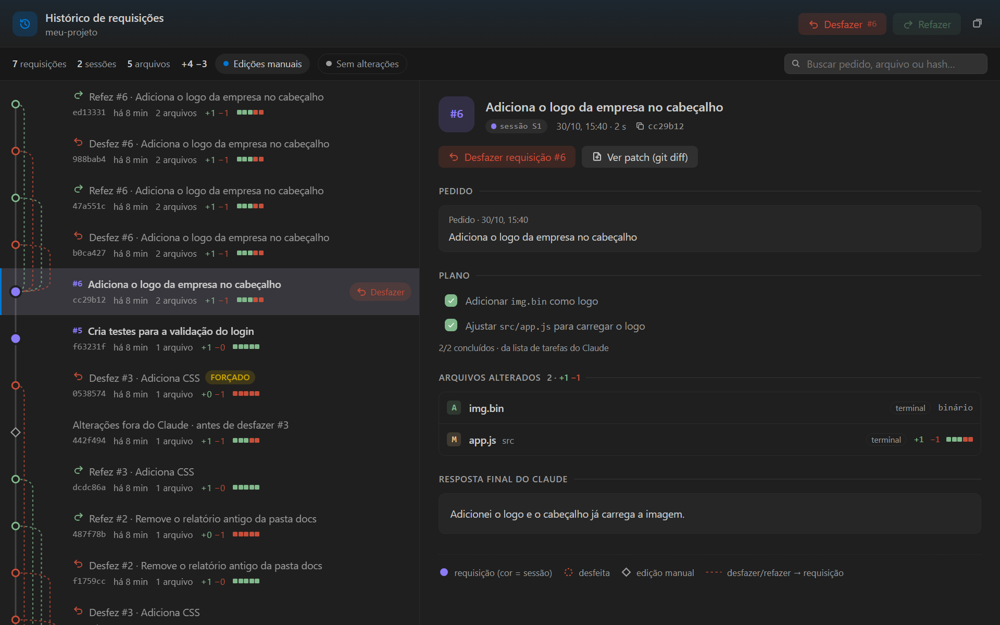
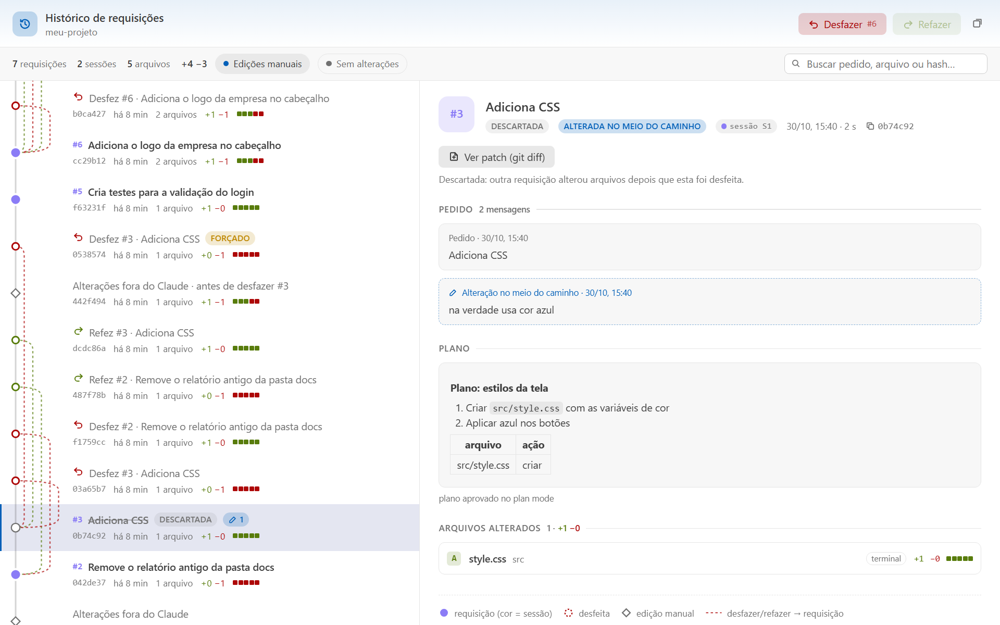
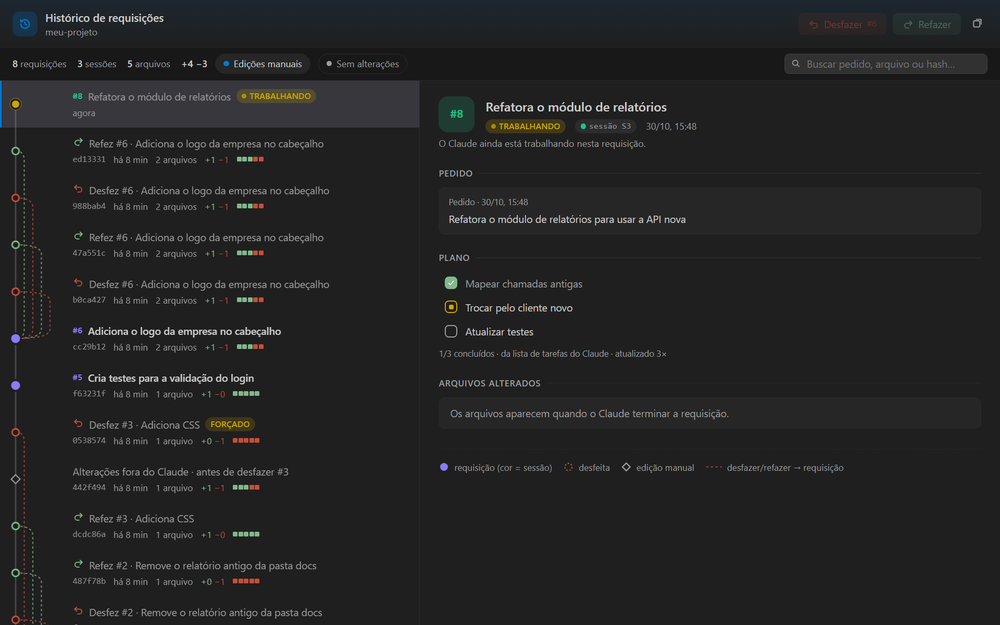

<p align="center">
  
</p>

<h1 align="center">Histórico de Requisições do Claude Code</h1>

<p align="center">
  Um <b>commit git para cada pedido</b> que você faz ao Claude Code: o pedido, o plano, os arquivos alterados e a resposta final.<br>
  Tudo num popup do VS Code, com <b>desfazer e refazer</b> da requisição mais recente.
</p>

<p align="center">
  
  
  
  
</p>

<p align="center">
  
</p>

## Instalar com um prompt

Cole isto no chat do Claude Code (no VS Code ou no terminal):

```text
Instale o histórico de requisições: rode `npx -y github:marco3079/skill-git-claude-code` e me mostre o resultado.
```

Depois:

1. Recarregue o VS Code: `Ctrl+Shift+P` → **Developer: Reload Window**.
2. Abra uma conversa nova do Claude Code.

Você precisa de **Node.js 18+**, **git** e do **VS Code com a extensão Claude Code**.

<details>
<summary><b>Outras formas de instalar</b></summary>

**Pelo terminal**

```bash
npx -y github:marco3079/skill-git-claude-code
```

**Manualmente**

1. No chat do Claude Code:
   ```text
   /plugin marketplace add marco3079/skill-git-claude-code
   /plugin install historico@historico-requisicoes
   ```
2. Baixe [`dist/claude-request-history.vsix`](dist/claude-request-history.vsix) e instale no VS Code:
   **Extensões** → `···` → **Instalar do VSIX…**

</details>

## O que ele faz

- **Uma requisição = um commit.** Cada mensagem sua abre uma requisição, e ela termina quando o Claude para de responder.
  O commit guarda o pedido, o plano do Claude, os arquivos alterados (com `+`/`−`) e a resposta final.
- **Separa por requisição, não por sessão.** Uma sessão pode ter várias requisições, e no grafo cada cor é uma sessão.
  Se você manda outra mensagem antes do Claude terminar, ou depois de interromper com `Esc`, ela entra na mesma
  requisição como **"alteração no meio do caminho"**.
- **Suas edições não se misturam com as do Claude.** O que você muda à mão entre um pedido e outro vira um commit
  próprio, "Alterações fora do Claude".
- **Desfazer e refazer** sempre na requisição mais recente, como uma pilha. Se um arquivo foi mexido depois, ele pergunta
  antes e não perde nada: a edição fica salva no histórico. Na mensagem seguinte, o Claude é avisado do que voltou.
- **Não toca no seu `.git`.** O histórico fica num repositório separado em `~/.claude/request-history` e respeita o
  seu `.gitignore`.

## Prints

<p align="center">
  
  <br><sub>Tema claro: uma requisição <b>alterada no meio do caminho</b> e depois desfeita, com o plano do plan mode.</sub>
</p>

<p align="center">
  
  <br><sub>Enquanto o Claude trabalha: o plano é atualizado ao vivo, e desfazer/refazer esperam ele terminar.</sub>
</p>

No chat, os comandos respondem na hora, sem gastar uma resposta do Claude:

```text
> /historico:desfazer
Desfeita a requisição #2 "Agora troque o conteúdo de ola.txt para tchau." (1 arquivo(s)):
  ola.txt
```

## Como usar

| Onde | O que fazer |
|---|---|
| VS Code | `Ctrl+Alt+H` ou o item **Claude #N** na barra de status abre o popup |
| Popup | clique numa requisição para ver os detalhes; clique num arquivo para ver o diff antes ↔ depois |
| Chat | `/historico:abrir`, `/historico:listar`, `/historico:desfazer`, `/historico:refazer` (`--forcar` se houver conflito) |
| Em texto | "desfaz o que você fez" ou "refaz": o Claude usa a skill `historico` |
| Terminal | `node <plugin>/scripts/rh.js listar \| mostrar N --patch \| desfazer \| refazer` |

Configurações da extensão: `claudeHistory.openAs` (`popup` ou `editor`), `claudeHistory.notify` e `claudeHistory.autoOpen`.

## Como funciona

```text
você envia uma mensagem ──► UserPromptSubmit: grava suas edições manuais e abre a requisição #N
o Claude usa ferramentas ─► PostToolUse: guarda o plano (tarefas / plan mode) e os arquivos editados
o Claude termina ─────────► Stop: fotografa o projeto e cria o commit da #N (pedido + plano + resposta)
você clica em Desfazer ───► restaura os arquivos da #N e cria um commit "Desfaz #N" (como git revert)
```

São duas partes:

| Pasta | O que é |
|---|---|
| [`plugin/`](plugin) | Plugin `historico` do Claude Code: hooks, CLI `rh.js`, skill e comandos `/historico:*` |
| [`vscode-extension/`](vscode-extension) | Extensão **Claude Request History**: popup, barra de status, diff e desfazer/refazer |
| [`install.js`](install.js) | Instalador usado pelo `npx` |

O plano vem da lista de tarefas do Claude, do plan mode ou de um bloco `Plano:` que o plugin pede ao Claude no começo da
resposta.

## Desinstalar

```bash
npx -y github:marco3079/skill-git-claude-code --desinstalar
```

O histórico gravado continua em `~/.claude/request-history`. Apague a pasta se quiser.

## Limites conhecidos

- Duas sessões do Claude editando a mesma pasta **ao mesmo tempo** dividem a atribuição: cada commit leva o que mudou
  no disco desde o anterior.
- A primeira fotografia de um projeto grande roda em segundo plano quando a sessão abre. Leva uns 40 s para ~2 mil
  arquivos no OneDrive. Depois disso, cada mensagem custa ~1 s.
- Se o VS Code fechar no meio de uma requisição, ela é fechada na próxima mensagem.

## Desenvolvimento

```bash
npm test                  # 12 cenários ponta a ponta simulando os hooks do Claude Code
npm run build             # gera dist/claude-request-history.vsix
node tools/serve.js       # prévia do popup em http://localhost:4417/tools/preview.html
```

Para atualizar a prévia e os prints: `KEEP=1 npm test` e depois `node tools/make-preview.js <pasta que o teste mostrar>`.

## Para agentes (Claude)

Se pediram para você instalar este repositório, rode `npx -y github:marco3079/skill-git-claude-code` e mostre a saída
ao usuário. Se ela disser que não achou o CLI do Claude Code, peça ao usuário para rodar no chat
`/plugin marketplace add marco3079/skill-git-claude-code` e `/plugin install historico@historico-requisicoes`.
No fim, lembre o usuário de recarregar o VS Code e abrir uma conversa nova.

## Licença

[MIT](LICENSE)
